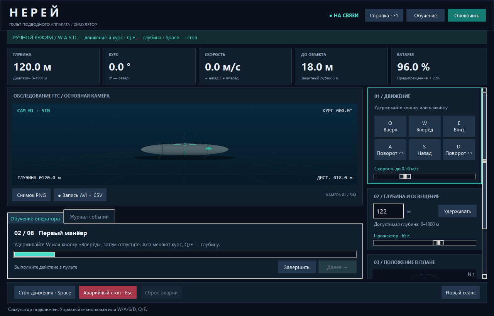

# Нерей — учебный пульт подводного аппарата

Приложение на Python и Tkinter для демонстрации телеуправления НПА. Работает в режиме симуляции: реальное оборудование не подключено.



## Возможности
- Управление движением и курсом с клавиатуры и экранных кнопок.
- Удержание заданной глубины, ограничение скорости, аварийная остановка.
- Синтетическая камера, телеметрия и схема положения аппарата.
- Пошаговое обучение из восьми заданий и справка по F1.
- Сохранение снимков PNG + JSON, видео AVI и телеметрии CSV.
- Экспорт журнала событий в TXT.

## Запуск в Windows
Требуется Python 3.13 с Tkinter. В PowerShell из папки проекта:

```powershell
python -m venv .venv
.\.venv\Scripts\python.exe main.py
```

Внешние Python-пакеты не нужны. Нажмите «Подключить» или «Обучение» → «Начать обучение».

W/S — вперёд/назад, A/D — поворот, Q/E — вверх/вниз. Space останавливает движение, Esc включает аварийную блокировку. После остановки отпустите удерживаемые клавиши перед новой командой.

## Проверки

```powershell
.\.venv\Scripts\python.exe -B -m unittest test_app -v
```

Тесты интерфейса открывают временное окно Tkinter и требуют графической среды.

## Структура
- `main.py` — интерфейс, обучение и обработка команд.
- `model.py` — модель аппарата и фильтрация ввода.
- `scene.py` — генератор синтетического изображения.
- `recording.py` — сохранение AVI и CSV.
- `test_app.py` — автоматические проверки.
- [Пояснительная записка](Пояснительная%20записка.md) — описание ТЗ, архитектуры и ограничений.

Результаты записи находятся в `captures/` и не включаются в Git. AVI несжатое, около 90 МБ/мин; лимит одного файла — 1 ГБ. Временные метки кадров доступны в CSV.

Параметры движения и защитные зоны условные. Прототип не заменяет инженерную проверку реального аппарата.
